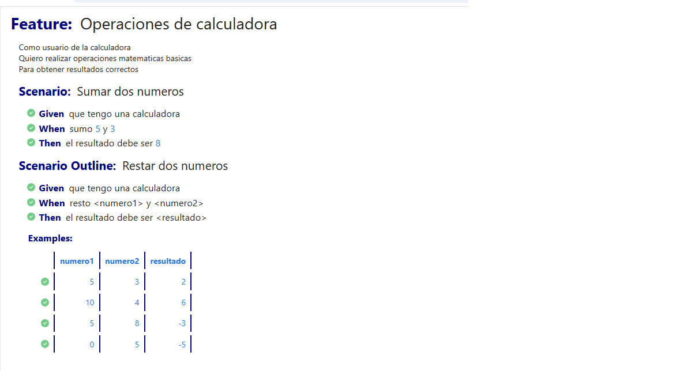
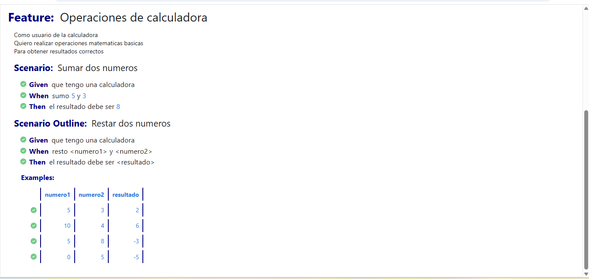
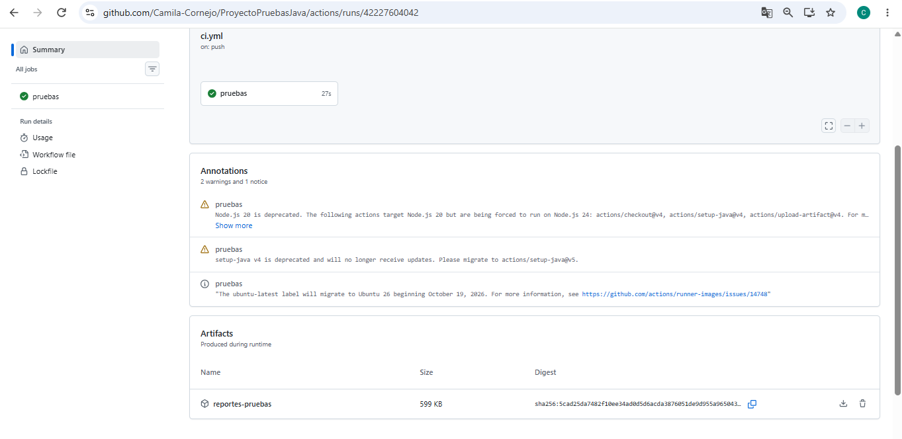
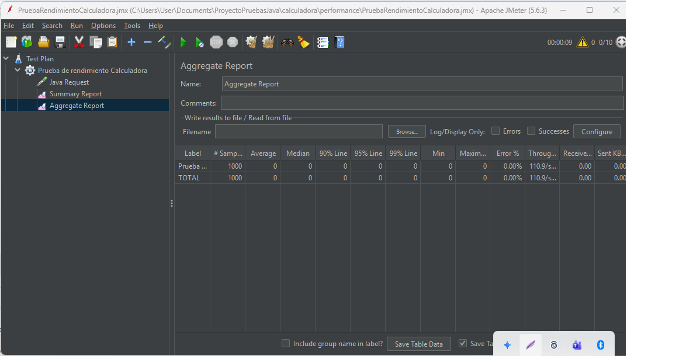
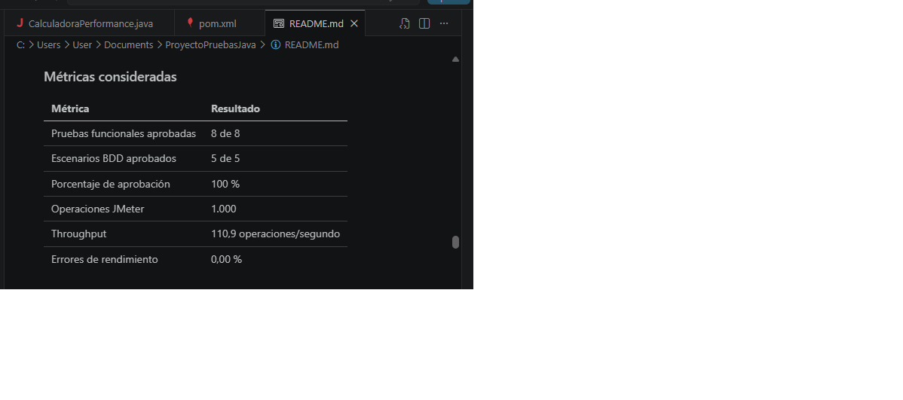
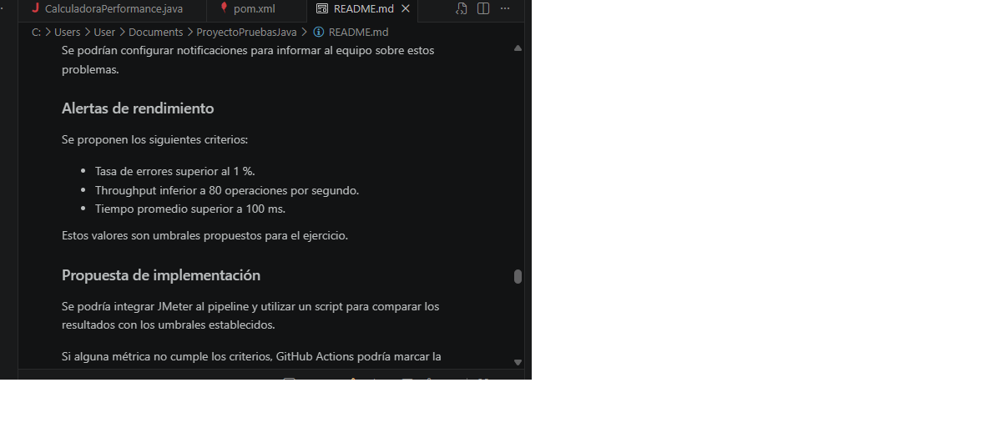

\# Proyecto de Pruebas Automatizadas Java

\## 1. Objetivo

Implementar pruebas automatizadas utilizando Java, Maven, JUnit y GitHub Actions, aplicando buenas prácticas de control de versiones e integración continua.

\## 2. Herramientas utilizadas

\- Java 17

\- Apache Maven 3.10.0

\- JUnit 5

\- Git y GitHub

\- GitHub Actions

\- Maven Surefire Report

\## 3. Estructura del proyecto

El proyecto utiliza la estructura estándar de Maven:

\- `src/main/java`: código fuente.

\- `src/test/java`: pruebas unitarias.

\- `pom.xml`: configuración de Maven.

\- `.github/workflows/ci.yml`: pipeline de integración continua.

\- `.gitignore`: exclusión de archivos temporales.

\## 4. Control de versiones

Se utilizó Git para gestionar los cambios mediante dos ramas:

\- `main`: rama principal.

\- `desarrollo`: rama de implementación y pruebas.

Los cambios se registraron mediante commits y se publicaron en GitHub.

\## 5. Pruebas unitarias

Se implementó una clase Calculadora con dos operaciones:

\- Suma: 5 + 3 = 8.

\- Resta: 5 - 3 = 2.

Las pruebas fueron desarrolladas utilizando JUnit 5, verificando cada operación de forma independiente.

\## 6. Ejecución de pruebas

Para ejecutar las pruebas desde la carpeta `calculadora`:

`mvn clean test`

Para generar el reporte HTML:

`mvn surefire-report:report-only`

\## 7. Integración continua

Se configuró GitHub Actions para ejecutar automáticamente las pruebas al realizar cambios en el repositorio.

El pipeline realiza las siguientes tareas:

1\. Descarga el código.

2\. Configura Java 17.

3\. Ejecuta las pruebas mediante Maven.

4\. Genera un reporte HTML.

5\. Publica los resultados como artefactos.

\## 8. Resultados obtenidos

\- Pruebas ejecutadas: 3.

\- Errores: 0.

\- Fallos: 0.

\- Pruebas omitidas: 0.

\- Porcentaje de éxito: 100 %.

\## 9. Reportes

Se utilizó Maven Surefire Report para generar un informe HTML navegable.

Los reportes están disponibles como artefactos descargables desde GitHub Actions bajo el nombre `reportes-pruebas`.

\## 10. Conclusión

Mediante este proyecto pude aplicar conocimientos relacionados con las pruebas automatizadas, el control de versiones y la integración continua.

La utilización de Java, Maven, JUnit y GitHub Actions permitió ejecutar las pruebas de manera automática y comprobar el correcto funcionamiento de las operaciones implementadas.

Además, los reportes HTML facilitaron la visualización de los resultados, contribuyendo a mejorar el seguimiento y la calidad del software.

# Actividad 2 - Pruebas BDD, Integración Continua y Rendimiento

## 1. Objetivo de la actividad

El objetivo de esta actividad es implementar pruebas
automatizadas utilizando BDD con Cucumber y Gherkin,
integrarlas al pipeline de GitHub Actions y evaluar
el rendimiento de la calculadora mediante Apache JMeter.

También se busca documentar los resultados obtenidos,
proponer un dashboard de métricas y definir alertas
automáticas para detectar posibles errores.

## 2. Sesión Tres Amigos

Se simuló una reunión entre tres participantes:

- Representante de negocio: definió las operaciones
  y los resultados esperados.
- Desarrollador: implementó los métodos de suma y resta.
- Analista QA: definió los escenarios y criterios
  de aceptación.

Durante la reunión se acordó comprobar las siguientes
operaciones:

- Sumar 5 + 3 y obtener 8.
- Restar 5 - 3 y obtener 2.
- Restar 10 - 4 y obtener 6.
- Restar 5 - 8 y obtener -3.
- Restar 0 - 5 y obtener -5.

Estos ejemplos se utilizaron posteriormente para
definir los escenarios de prueba mediante Gherkin.

## 3. Escenarios de prueba Gherkin

Se utilizó Gherkin para describir el comportamiento
esperado de la calculadora mediante los pasos
Given, When y Then.

Los escenarios se encuentran en el archivo:

`calculadora/src/test/resources/features/calculadora.feature`

Se implementaron los siguientes casos:

- Sumar dos números: 5 + 3 = 8.
- Restar dos números utilizando Scenario Outline.
- Ejecutar cuatro ejemplos de resta con diferentes valores.

En total se ejecutaron cinco escenarios BDD,
todos aprobados correctamente.

## 4. Implementación de Step Definitions

Se utilizó Java junto con Cucumber para conectar
los escenarios Gherkin con los métodos de la calculadora.

Archivo implementado:

`calculadora/src/test/java/cl/iplacex/pruebas/steps/CalculadoraSteps.java`

Se utilizaron las siguientes anotaciones:

- @Given: inicializa la calculadora.
- @When: ejecuta las operaciones de suma y resta.
- @Then: comprueba el resultado esperado mediante
  assertEquals de JUnit.

Esta implementación permitió automatizar los escenarios
y comprobar el funcionamiento de las operaciones.

Al ejecutar las pruebas mediante Maven se obtuvieron
ocho pruebas aprobadas, sin errores ni fallos.

## 5. Integración continua con GitHub Actions

Se integraron las pruebas automatizadas al pipeline
de integración continua utilizando GitHub Actions.

El archivo de configuración se encuentra en:

`.github/workflows/ci.yml`

El pipeline permite:

- Descargar el código desde GitHub.
- Configurar Java 17.
- Ejecutar las pruebas JUnit y Cucumber mediante Maven.
- Generar reportes de resultados.
- Publicar los reportes como artefactos descargables.

El comando utilizado para ejecutar las pruebas es:

`mvn clean test`

Resultados obtenidos:

- Pruebas ejecutadas: 8.
- Pruebas aprobadas: 8.
- Fallos: 0.
- Errores: 0.
- Estado del pipeline: exitoso.

## 6. Generación de reportes BDD

Se configuró Cucumber para generar un reporte HTML
con los resultados de los escenarios ejecutados.

El archivo generado se encuentra en:

`calculadora/target/cucumber-report.html`

Este reporte permite visualizar:

- Los escenarios definidos en Gherkin.
- Los pasos Given, When y Then.
- El resultado de cada escenario.
- Los escenarios aprobados y fallidos.

Se ejecutaron cinco escenarios BDD, todos aprobados.

Además, GitHub Actions publica los reportes como
artefactos descargables con el nombre:

`reportes-pruebas`

Esto facilita la revisión y el seguimiento de
las pruebas automatizadas.

## 7. Pruebas de rendimiento con Apache JMeter

Para evaluar el rendimiento de la calculadora se utilizó
Apache JMeter 5.6.3, una herramienta que permite simular
usuarios virtuales y medir el comportamiento del sistema.

Se implementó la clase CalculadoraPerformance.java
para ejecutar y validar la operación de suma.

El archivo de configuración de JMeter se encuentra en:

`calculadora/performance/PruebaRendimientoCalculadora.jmx`

### Configuración de la prueba

- Usuarios virtuales: 10.
- Ramp-up: 10 segundos.
- Repeticiones por usuario: 100.
- Total de operaciones: 1.000.

### Resultados obtenidos

| Métrica | Resultado |
|---|---|
| Operaciones ejecutadas | 1.000 |
| Throughput | 110,9 operaciones/segundo |
| Tiempo promedio | 0 ms (redondeado) |
| Tasa de errores | 0,00 % |

### Análisis

La prueba permitió ejecutar 1.000 operaciones de suma
sin registrar errores.

El throughput fue de aproximadamente 110,9 operaciones
por segundo, lo que representa la cantidad de operaciones
procesadas durante la ejecución.

El tiempo promedio se mostró como 0 ms debido al
redondeo de los valores en el reporte de JMeter.

Estos resultados permiten comprobar el comportamiento
de la calculadora bajo la carga configurada.

La prueba de rendimiento se ejecutó localmente y
todavía no está integrada al pipeline de GitHub Actions.

## 8. Dashboard de métricas

Se diseñó una simulación de dashboard para visualizar
los resultados de las pruebas funcionales y de rendimiento.

El objetivo es centralizar las métricas y facilitar
el seguimiento de la calidad del software.

### Métricas consideradas

| Métrica | Resultado |
|---|---|
| Pruebas funcionales aprobadas | 8 de 8 |
| Escenarios BDD aprobados | 5 de 5 |
| Porcentaje de aprobación | 100 % |
| Operaciones JMeter | 1.000 |
| Throughput | 110,9 operaciones/segundo |
| Errores de rendimiento | 0,00 % |

### Propuesta de integración

GitHub Actions ya ejecuta las pruebas funcionales
y publica sus reportes como artefactos descargables.

Como mejora futura, se propone incorporar JMeter
al pipeline para ejecutar pruebas de rendimiento
automáticamente y generar reportes de sus resultados.

Estos datos podrían integrarse en un dashboard
para visualizar el estado general del proyecto.

El dashboard presentado corresponde a una simulación.

## 9. Alertas automáticas

Se propone implementar alertas automáticas para
detectar fallos funcionales y degradaciones
del rendimiento de la aplicación.

### Alertas funcionales

GitHub Actions permite identificar fallos en las
pruebas JUnit y Cucumber, marcando el pipeline
como fallido cuando se detectan errores.

Se podrían configurar notificaciones para informar
al equipo sobre estos problemas.

### Alertas de rendimiento

Se proponen los siguientes criterios:

- Tasa de errores superior al 1 %.
- Throughput inferior a 80 operaciones por segundo.
- Tiempo promedio superior a 100 ms.

Estos valores son umbrales propuestos para el ejercicio.

### Propuesta de implementación

Se podría integrar JMeter al pipeline y utilizar
un script para comparar los resultados con los
umbrales establecidos.

Si alguna métrica no cumple los criterios,
GitHub Actions podría marcar la ejecución como
fallida y generar una notificación al equipo.

Las alertas de rendimiento todavía no están
implementadas y se presentan como una propuesta.

## 10. Evidencias de ejecución

En esta sección se presentan las capturas de pantalla
que respaldan las actividades realizadas.

### Evidencia 1. Escenarios BDD ejecutados

### Evidencia 2. Reporte HTML de Cucumber

### Evidencia 3. Pipeline de GitHub Actions

### Evidencia 4. Prueba de rendimiento JMeter

### Evidencia 5. Dashboard de métricas (simulación)

### Evidencia 6. Propuesta de alertas automáticas

## 11. Conclusión de la Actividad 2

Esta actividad permitió implementar pruebas automatizadas
con JUnit y Cucumber, integrarlas con GitHub Actions
y ejecutar pruebas de rendimiento mediante Apache JMeter.

También se propuso un dashboard para visualizar métricas
de calidad y un sistema de alertas automáticas.

Considero que estas herramientas permiten detectar
errores oportunamente, mejorar el seguimiento de las
pruebas y mantener la calidad del software.
